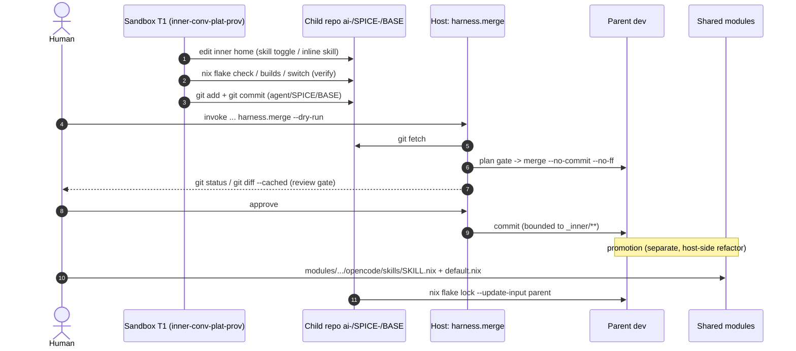
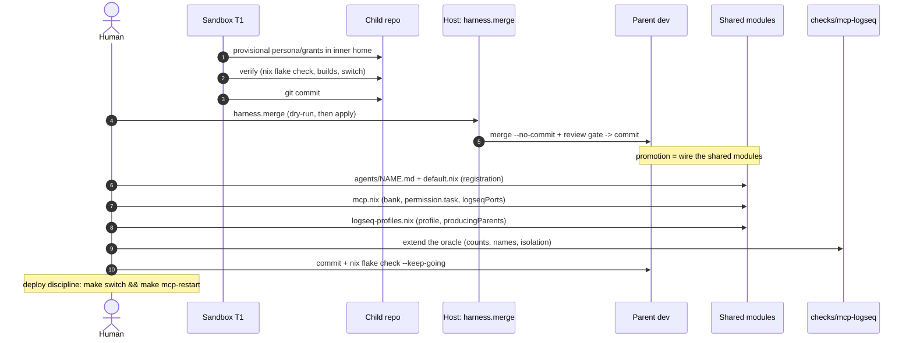
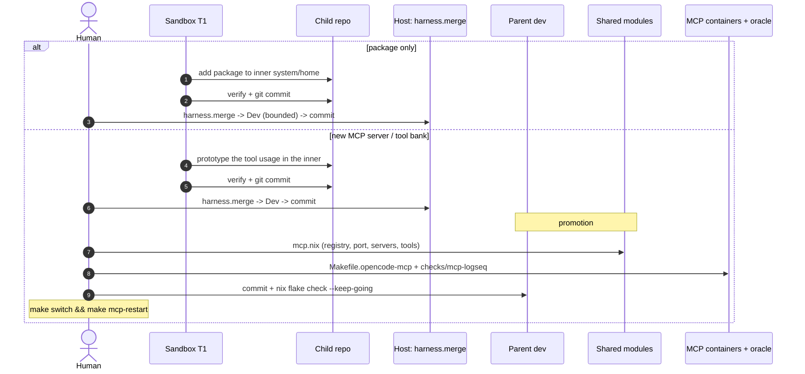

# Guide — Iterating on the agent harness (`inner → merge → promote`)

**Audience:** a human operator on the host, and the in-sandbox provisioner
agents (`<spice>-inner-conv-plat-prov`, `harness-conv-plat-prov`).

**Companions:** [ADR 0007](../adr/0007-agent-harness-iteration-and-merge-gates.md)
(merge gates), the child-flake RFC
[agent-child-flake-inheritance](../rfc/agent-child-flake-inheritance.md)
(substrate), and [extending-harness-to-other-machines](../rfc/extending-harness-to-other-machines.md)
(adding a machine).

The executable mechanism is the **`harness` invoke collection** (`tasks/harness/`).
The `/merge-harness` and `/bootstrap-child-flake` opencode commands and the
`make harness-*` targets are thin wrappers — no logic lives outside the tasks.

Placeholders used below:

- `<spice>` — the spice namespace (e.g. `darkGreen`), from `common.spiceNamespace`;
- `<base>` — the system base name (e.g. `tangerineDream-green`), from `common.systemBaseName`;
- `<user>` — the container user (often `<base>`);
- `<system>` — `<spice>-<base>`;
- `<child>` — the child checkout `ai-/<spice>-/<base>` (note the trailing `-`).

## Two edit surfaces

| Surface | Lives in | Edited by | Lands via |
| --- | --- | --- | --- |
| **Inner delta** (bounded) | child `<child>`: `systems/x86_64-linux/<system>_inner/**` and `homes/x86_64-linux/<user>@<system>_inner/**` | the sandbox (T1 `<spice>-inner-conv-plat-prov`) | `harness.merge` into parent `dev` |
| **Shared harness** | parent `modules/home/apps/ai-assistance/opencode/**`, `lib/**`, `packages/**`, `checks/**`, `docs/**` | the host (human) | direct commit on `dev`; the child re-locks `parent` |

The inner surface is a **complete NixOS/home definition**, so it is fully
expressive (skills, agent definitions, packages, tool config). The normal
pattern is therefore: **prototype in the inner** (where the sandbox has the
context), **merge** the bounded delta back, then **promote** — a *separate,
host-side* refactor into the shared modules. Drift between the inner prototype
and the shared harness is expected and intended.

Only two things are hard boundaries, and they are *not* permission tiers: the
**bounded-delta check** (`harness.merge` aborts on anything outside the two
`_inner` trees) and the **host review gate**.

## Generic algorithm

### 0. One-time bootstrap (host)

```sh
invoke --search-root=./tasks harness.selfcheck          # validate classify map + derived paths
invoke --search-root=./tasks harness.bootstrap          # --spice/--agent/--user to override
```

Creates `ai-/<spice>-/<base>` as a blobless partial clone with a sparse working
tree containing only the two `_inner` paths; `origin` is removed and the child
scaffolding is excluded. The deployment mounts it as `UNIX_DOTFILES_AI`. An
existing checkout is **moved aside** (`.bak-<ts>`), never deleted.

### 1. Author (sandbox)

Edit **only** the two inner trees. Anything else makes the delta out-of-bounds
and `harness.merge` aborts.

### 2. Verify (sandbox)

```sh
nix flake check
nixos-rebuild build --flake .#<system>_inner --impure
home-manager build --flake .#<user>@<system>_inner

# behavioural proof, when the change is behavioural:
sudo nixos-rebuild switch --flake .#<system>_inner --impure
#   then assert the capability appeared (command -v <tool>, skill enabled,
#   make oc-skills / oc-agents, make mcp-logseq-check)
```

Carry a **change ↔ acceptance criterion ↔ evidence** mapping.

### 3. Commit (sandbox)

```sh
git add systems/x86_64-linux/<system>_inner \
        homes/x86_64-linux/<user>@<system>_inner
git commit    # message: scope, rationale, evidence, risk, rollback
```

On branch `agent/<spice>/<base>`. **No push, no network.**

### 4. Merge (host)

```sh
invoke --search-root=./tasks harness.merge --dry-run   # discover + classify, no tree change
invoke --search-root=./tasks harness.merge             # plan gate -> review-state merge -> host gate -> commit
```

- **plan gate** — approve the bounded inner delta before any mutation;
- **review-state merge** — `git merge --no-commit --no-ff`, then it prints
  `git status` / `git diff --cached` and **stops**;
- **host review gate** — the human reviews the ACTUAL staged code, then commits;
- a conflict **aborts**; it is never auto-resolved.

### 5. Promote (host, optional)

```sh
invoke --search-root=./tasks harness.merge --promote   # derive layout-based outer targets
```

Then refactor the merged inner prototype into the **shared harness modules**.
Promotion is a deliberate human edit (both to the outer image targets and to the
shared modules), never automatic.

### 6. Refresh the child (sandbox)

After a shared-module change lands on `dev`:

```sh
nix flake lock --update-input parent
```

then re-run the in-container switch.

## Case 1 — simple: skill modification

Two sub-cases, both cheap:

- **Toggle / parameterise** an existing skill -> inner only. In the inner home:
  `ds-omega.ai-assistance.opencode.enabledSkills.<skill> = false;` (or an inner
  override). No shared-module change; merge and you are done.
- **Change the skill's content** -> prototype in the inner (an inline skill or
  an overridden path), merge, then **promote** into
  `modules/home/apps/ai-assistance/opencode/skills/<skill>.nix` (and its
  `imports` / `enabledSkills` entry in `opencode/default.nix`).



## Case 2 — complex: agent-definition change

An agent definition is a **shared-harness** change with several coupled
touch-points. Prototype it in the inner (define a provisional persona/grants in
the inner home so it evaluates in-container), merge, then promote by wiring the
shared modules:

| Part | Shared module |
| --- | --- |
| Persona (frontmatter: `mode`, `temperature`, `steps`, `permission`) | `modules/home/apps/ai-assistance/opencode/agents/<name>.md` |
| Persona registration | `modules/home/apps/ai-assistance/opencode/default.nix` (`programs.opencode.agents.<name>`) |
| Tool bank + permission/task grants | `modules/home/apps/ai-assistance/opencode/mcp.nix` (`settings.agent.<name>`) |
| Logseq namespace profile (if the agent produces knowledge) | `modules/home/apps/ai-assistance/opencode/logseq-profiles.nix` (`agentProfiles`, `producingParents`) |
| Logseq port + summarizer port | `modules/home/apps/ai-assistance/opencode/mcp.nix` (`logseqPorts`) |
| Static oracle (counts, names, isolation, delegation) | `checks/mcp-logseq/default.nix` |

Notes: agent names on the *darkGreen* capability axis are **namespace-generated**
(`<spiceNamespace>-inner-conv-plat-prov`); a generic subagent keeps a fixed name
(`harness-conv-plat-prov`). Adding a knowledge-producing agent also implies a
`<name>-kbn` summarizer counterpart, a summarizer port, and oracle entries — the
`checks/mcp-logseq` oracle count changes accordingly.



## Case 3 — complex: tooling addition

Two flavours:

- **A package the agent needs** (the `git` example) -> usually **inner-only**:
  add it to the inner system's `environment.systemPackages` (or the inner home's
  packages). Merge; nothing shared changes.
- **A new MCP server / tool bank** -> shared-harness. Touch-points:

| Part | Shared module |
| --- | --- |
| Container registry (image, port, endpoint, stdio, volumes) | `modules/home/apps/ai-assistance/opencode/mcp.nix` (`mcpContainers.servers`) |
| Host-port allocation | `modules/home/apps/ai-assistance/opencode/mcp.nix` |
| OpenCode server wiring | `modules/home/apps/ai-assistance/opencode/mcp.nix` (`settings.mcp.servers`) |
| Tool bank exposure per agent | `modules/home/apps/ai-assistance/opencode/mcp.nix` (`settings.tools` / `settings.agent.<name>.tools`) |
| Packaged artifact (if built by Nix) | `packages/<name>/` |
| Verify wrappers | `Makefile.opencode-mcp` / `checks/mcp-logseq` |
| Host glue (secrets/env) | the host's `apps/ecosystem/sops-opencode` module |



## What changes where — quick reference

| Change | Inner (`_inner/**`) | Shared harness | Outer image |
| --- | --- | --- | --- |
| enable/disable a skill | yes | — | — |
| skill content | prototype | `modules/.../opencode/skills/**` + `default.nix` | — |
| agent persona/grants | prototype | `agents/*.md`, `default.nix`, `mcp.nix`, `logseq-profiles.nix`, `checks/mcp-logseq` | — |
| install a CLI tool | yes | — | — |
| new MCP server | prototype | `mcp.nix`, `Makefile.opencode-mcp`, `checks/mcp-logseq` | — |
| outer/system closure change | — | — | rebuild + re-import |

Only `_inner/**` can travel through `harness.merge`; everything in the *shared
harness* and *outer image* columns is a deliberate host edit.

## Invoke tasks reference

| Task | Purpose |
| --- | --- |
| `harness.bootstrap` | create the child checkout (blobless sparse clone) |
| `harness.classify` | print the merged classification map + derived layout paths |
| `harness.selfcheck` | validate `classify.json` + derived paths (no git, no writes) |
| `harness.merge` | fetch -> classify -> plan gate -> review-state merge -> host gate -> commit; `--dry-run`, `--yes`, `--promote` |

`make harness-test`, `make harness-selfcheck`, `make harness-classify`,
`make harness-bootstrap[-dry]`, `make harness-merge[-dry]`, `make harness-promote`
wrap these.
